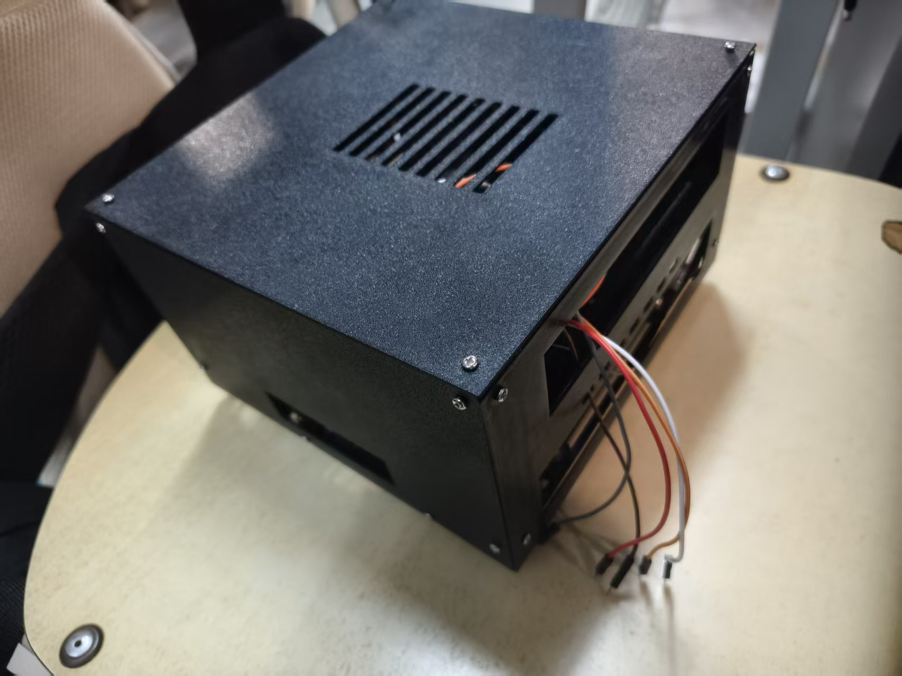
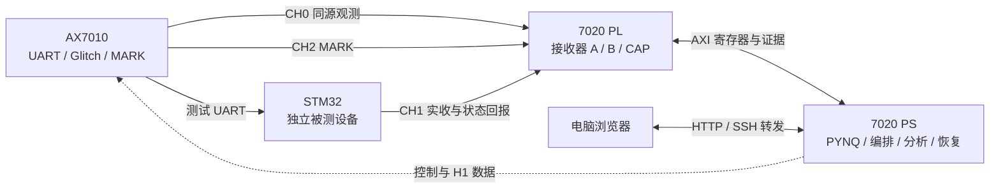

<div align="center">

# GLITCHSCOPE

**嵌入式通信容错测评平台**

FPGA-based UART resilience testing, receiver tuning, and CRC-guided image recovery.


[快速上手](#快速上手) · [三项核心功能](#三项核心功能) · [实测结果](#实测结果) · [设计报告](report/design_report/design_report.pdf) · [完整文档](docs/project_overview.md)

</div>

GLITCHSCOPE 面向嵌入式 UART 通信的抗扰测试、接收参数比较和受损数据恢复。平台使用 AX7010 产生可控扰动，使用 Zynq-7020/PYNQ 并行观测、运行接收策略和组织实验，并由独立 STM32 被测设备返回实际接收结果。

在浏览器中配置实验、观察容错热力图、比较图片恢复结果、查看采样与三点表决，并追溯每次任务的参数和原件来源。

> **English overview** — An open-source hardware/software platform for repeatable UART fault experiments. It combines programmable glitch generation, parallel FPGA receivers, independent DUT feedback, bounded rule/AI sampling, image recovery, and local-waveform receiver analysis in one traceable workbench.

<p align="center">
  
  <br><sub>已装配的 v16 外壳：7020 位于下层，7010 位于上层；独立 STM32 被测设备置于壳外。</sub>
</p>

## 三项核心功能

| 功能 | 你可以做什么 | 主要输出 |
| --- | --- | --- |
| **容错热力图** | 配置毛刺相位、宽度、字节、位号、连续点数及重复次数；选择顺序扫描、规则细化或边缘 AI 选点 | B 完整帧、STM 载荷和 STM 业务三张热力图；格点统计与决策记录 |
| **图片传输与修复** | 上传图片，选择整图统一接收参数与固定、随机或无扰动计划；比较多路实收及 CRC 约束恢复 | 原始接收图、恢复图、差异与缺失掩码、滑块对比、整图 SHA 校验 |
| **接收策略与波形** | 在共同局部窗口上比较 14 组合法 d/s，切换 ITEM、保留初相、字节和位，查看三点表决 | 统一软件候选、评分上下界、三轨迹、表决明细及 JSON/CSV/SVG |

三项功能共用任务计划、会话编号、记录预算和证据归档。任务进度固定显示；原始反馈、软件推演和历史结果分别保留来源。

### 实验记录

- 每次任务显示会话名称、实际编号、参数和计划 SHA。
- CONFIG、无扰动参照和 ITEM 均计入硬件记录；预览、分析、恢复与导出不新增硬件试次。
- 有效业务失败保留在统计中；UNKNOWN 独立记账并阻断后续，不自动重试、续跑或退款。
- 可导出配置、热力图、图片、波形和报告，回到具体记录复核。

## 系统架构



| 模块 | 职责 |
| --- | --- |
| AX7010 / Zynq-7010 | 测试数据缓存、UART 发送、单点与连续多点毛刺、MARK 与控制事件 |
| 领航者 V2 / Zynq-7020 PL | 物理输入采样、固定单点接收器 A、可调三点表决接收器 B、局部快照 |
| Zynq-7020 PS / PYNQ | 计划编排、RT 接收、规则/AI 选点、统计、CRC 恢复、统一 d/s 分析与网页服务 |
| STM32F103C8 | 实际 UART 接收与状态反馈，作为独立 DUT |

当前主线采用 Direct 拓扑：A/B 并行观察与 STM32 相同的测试输入。网页服务与算法运行在 7020 PS，电脑浏览器负责交互与展示。

测试 UART 名义速率为 **1 Mbit/s**；B 支持 **14 组合法 d/s**；图片为 **128×128、8 位灰度、64 个 ITEM**。CAP 是 **4096 点局部窗口**。当前时钟配置的约 100 MHz 推算口径见[时钟说明](docs/clock_reference.md)。

## 实测结果

| 实验 | 已归档结果 | 解释范围 |
| --- | --- | --- |
| 两幅图统一参数配对 | B 完整帧累计位错 **2398 → 1672**、**1855 → 1199**，分别减少 **30.28%**、**35.36%** | 同图、同种子计划下比较基线与候选；四个会话共 260 条有效记录 |
| 有界稀疏选点 | 规则与 AI 各 **14 条**，完整参照 **44 条**，记录减少 **68.18%** | 两种稀疏策略均覆盖 **4/14 格点**，同时报告成本与覆盖 |
| 新 SD 图片恢复 | **65 条**严格完成记录；多路 CRC 恢复 **0 错误像素**，整图 SHA 匹配 | 对应一个已归档样本；仅 B 的 CRC 恢复仍有 425 个错误像素 |
| 统一参数软件分析 | **64/64** 局部窗口、**1024** 评分位，候选 d4/s−2 | 局部软件排名与完整传输实测分别评价 |

这些结果对应各自的固定条件和证据范围。稀疏选点不等于重建完整地图；CRC 候选恢复具有明确错误模型；局部 d/s 候选不等于 14 组参数的硬件全局最优。

查看[设计报告](report/design_report/design_report.pdf)、[新 SD 验收记录](docs/fresh_sd_acceptance_20261101.md)、[选点方法](docs/selection_methods.md)及 [verification](report/verification/) 了解条件、分母与来源。

## 快速上手

### 电脑预览

使用 Python 3.8 或更高版本，在电脑上安装界面与推理依赖：

```bash
git clone https://github.com/caoc30255-eng/glitchscope.git
cd glitchscope
python -B build/create_empty_directories.py
python -m pip install -r requirements.txt
python -B board/start_preview.py
```

打开 **http://127.0.0.1:8780/**，可生成计划、查询模型、上传图片并查看随包提供的结果。电脑预览不访问 FPGA。

### 校验与软件测试

```bash
python -B build/verify_release.py
python -B src/ps/workbench/software_check.py --output ../glitchscope_check_01
```

输出目录必须在源码外且尚不存在。Git 不记录空目录，首次克隆命令中的以下步骤用于恢复所需空目录：

```bash
python -B build/create_empty_directories.py
```

仓库使用 `.gitattributes` 保持文件原始字节，避免自动换行转换破坏冻结模型或校验值。

### 三板实测

按[首次部署](docs/first_installation.md)准备匹配领航者 7020 的 PYNQ 镜像，再按[复现指南](docs/fresh_reproduction.md)完成板端检查、原生库编译、新安装初始化与网页启动。接线、实际器件、工具版本和固件均需与交付资料核对。

进入网页后确认本轮任务范围与额度，预览计划，再初始化执行。完整网格、规则与 AI 共用同一执行链；图片传输使用整图统一 B 参数。

## 文档导航

| 内容 | 入口 |
| --- | --- |
| 原理、算法、实测与复现 | [39 页设计报告](report/design_report/design_report.pdf) |
| 架构及指标定义 | [项目说明](docs/project_overview.md) |
| 工具链与构建 | [复现指南](docs/fresh_reproduction.md) |
| 目标板首次安装 | [首次部署](docs/first_installation.md) |
| 接收参数、规则与 AI | [选点方法](docs/selection_methods.md) |
| 外壳与交互装配指南 | [机械资料](hardware/enclosure/README.md) |
| 实物照片与装配检查 | [装配记录](hardware/measured_enclosure_fit/README.md) |
| 大模型协作与纠错 | [协作记录导读](docs/llm_collaboration.md) |
| 可复用工程方法 | [七项技能](skill/README.md) |
| 发布与验证范围 | [发行说明](docs/release_notes.md) · [公开版说明](docs/public_release.md) |

## 工程目录

```text
glitchscope/
├── src/
│   ├── pl/           # 7010 / 7020 RTL、约束与设计
│   ├── ps/           # PYNQ工作台、算法及原生RT服务
│   └── stm32/        # 独立DUT固件与Keil工程
├── sim/              # 仿真、参考模型及验证材料
├── build/            # 构建入口、资源和时序报告
├── board/            # 已验证固件与部署脚本
├── data/             # 测试数据说明
├── hardware/         # v16外壳、STL、装配指南与实拍
├── skill/            # 七项独立技能与验证入口
├── report/           # 设计报告、协作记录和验证摘要
└── docs/             # 使用、复现与发布文档
```

本仓库包含已验证的执行工件和分阶段构建记录。统一构建入口的能力与既有结果范围按文档分别说明，不将本次公开整理记为新的整轮 EDA 构建或实板验收。

## 公开数据与许可证

公开版保留代码、模型、固件、实测统计和必要局部波形。完整演示图片、完整历史接收帧及私有评审资料不随仓库分发；可上传自备图片或使用合成测试数据运行功能。派生关系见 [public_projection_manifest.json](public_projection_manifest.json)。

自有代码采用 [MIT License](LICENSE)。厂商 IP、字体、启动文件和第三方依赖沿用原许可，见[第三方说明](third_party_notices.md)。源码 MIT 不对第三方资源重新授权。

问题与改进建议欢迎通过 [Issues](https://github.com/caoc30255-eng/glitchscope/issues) 提交。
