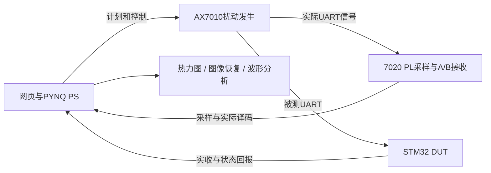

# 项目说明

## 系统分工

AX7010（Zynq XC7Z010-CLG400）发送测试 UART 和可控毛刺。领航者 V2（XC7Z020-CLG400，工程 part 以 Tcl 为准）PL 进行采样、固定接收器 A 和参数化接收器 B 译码并保存寄存器证据；PS 使用 PYNQ、原生 RT UART 线程和网页工作台编排实验。STM32F103C8 独立接收并报告原始字节、载荷正确性与业务状态，不运行平台调度或 AI。

## 核心一：容错边界

可配置 d/s、毛刺字节/位/相位/宽度、单点/连续/无扰动、载荷、格点与重复次数。网格、规则与 AI 共享真实执行和反馈链；AI 只建议受范围与预算约束的下一格，不能批准任务、扩大额度或给不支持条件编造概率。完整地图与少量主动选点的观测覆盖率分别标识。

规则与边缘AI均作为减少实测选点的并列方法，以完整网格为主要参照，报告记录节省、覆盖、边界触达和未测区域；不要求AI优于规则。具体定位和验收见 [selection_methods.md](selection_methods.md)。

## 核心二：传图与恢复

浏览器将用户图片转换为 128×128 灰度数据。每幅图 CONFIG1＋ITEM64，总上限65条；一个 ITEM 可含多个毛刺，但计为一条执行记录。A/B/STM32图像分别由各自实收字节重建。crc_burst_B 在接收 CONFIG 的块 CRC 约束下恢复 B 路候选突发错误；crc_burst_multi 使用多路实收证据和 CRC 组合恢复。恢复无解或有歧义时须保留未知/估计标记，不能承诺任意图片零误差，也没有通过源图替换损坏像素。

## 核心三：统一 d/s 与局部波形

14组合法域：d=1..4，s=-2..3-d。对全图64个 ITEM 使用同一组候选，不允许逐块挑不同配置后合并成一个“统一结果”。采样窗口为局部 CAP，不是整帧连续波形；保留初相不确定性、未测区域和误码上下界。原配置实收值与其他 d/s 的软件推演分开展示。推荐区域是经过给定规则筛选的区域，不等于所有硬件配置已逐一测得全局最优。

## 三个判据

- B完整帧正确：B 实际译码帧与参考帧一致。
- STM载荷正确：STM32 实收到的业务载荷与参考相符。
- STM业务成功：设备业务校验、状态和回报满足协议要求。

三者不能相互替代；完整帧错误不必然表示载荷错误，载荷正确也不保证业务成功。控制通信异常、采集证据缺失和UNKNOWN不是被测失败的替代标签。

## 会话与计数

初始化后显示真实 session_XXXXXXXX 目录及操作者任务别名。先预留任务上限，进入每条硬件执行尝试才占用，严格退役后计为完成；CONFIG、参照与 ITEM 都计入。已完成是已占用的子集，不重复相加。未知尝试不退款，未关闭资源时不释放余量；没有自动重试、续跑或复位7010。

## 时钟工作条件

本装置当前FCLK0按板卡参考晶振和寄存器推算约100MHz；PYNQ按错误的50MHz参考值显示150MHz。保留原运行设置，不称为实际150MHz；时序采用100MHz报告。详见 clock_reference.md，尚未做仪器测频。
