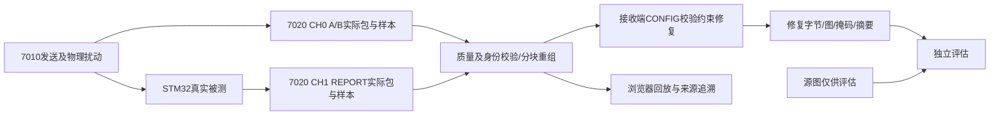

# 功能交付报告 v0.1 · 2026-10-19

责任人：本次由当前交付端统一负责 M1 规划/聚合、M2 算法、M3 接收修复及 M4 软件界面，不假定另有已认领人员。旧 v0.6 与原件保留，本版另行发布。

| 功能 | 实际入口 | 可见结果 | 仍需主线提供 |
|---|---|---|---|
| M1 扫描与图：软件完成，真实完整网格未采集 | 浏览器扫描页；scans.py、render.py | 不可变计划、明确总次数、开发模拟；真实 d3 的 p15/w20 为 B 0/3、STM 0/3，d4 为 B 1/1、STM 0/1；其余显示未测 | 新版有界扫描执行器、实际 START/DONE 与退役接口、分别批准 d3/d4 预算并采集 |
| M2 算法：合成开发完成，真实加速未验收 | learner.py；algorithm-demo；infer | 实际拟合/后验/选点/模型加载；5 种种子、B/STM 分别比较；提供目标 ARM 同代码推理入口 | 真实训练授权、按会话分组数据、等精度基线、目标板连接及计时 |
| M3 图片：离线真实证据流程完成 | evidence.py、images.py；图片页 | session24 的 192 个 A/B/STM 实际包解码，64块×3路重组；四算法、字节/图/掩码/指标导出 | 最终实时接收数据路径、接口权限和目标硬件联调 |
| M4 统一界面：模拟及回放完成，硬件执行未接通 | main.py serve | 操作实际后端，幂等、独占模拟、STOP、UNKNOWN阻断、刷新不自动启动、导出；主线提交明确拒绝 | 新执行器和权限适配、实际反馈与严格退役联调；最终 M4 验收仍未完成 |

## 扫描建议与真实证据

默认 phase=[5,15,25,35]、width=[1,10,20,30,40]，14合法/6非法。固定载荷00…ff共256字节、字节偏移20、bit0、s=-1、每ITEM一段连续1字节，d3/d4分开。每点3次：CONFIG1+无扰动参照1+ITEM42=44次/计划；两个计划共88次仅是建议，尚无硬件授权。没有从旧四条或65条额度借用次数。

发生器 tick 名义20ns，CAP样本 tick 名义10ns；未混用。B完整帧、STM载荷、STM业务标签各自统计。同一固定条件才进入同图，随机图片压力数据不归入边界扫描。历史 session20 UNKNOWN 无已审核坐标绑定，保留为未定位 UNKNOWN，不补入格点。当前稀疏记录不能给出完整真实边界。

## 算法结果与限制

实际实现 RBF 核后验估计，Cholesky 求解，模型保存拟合矩阵及摘要；评分采用不确定度与边界邻近度，停止采用后验阈值，不读取模拟真值决定停止。模型仅接受 SIMULATED_DEVELOPMENT 数据；真实数据训练接口仍关闭。五种种子为11/22/33/44/55，B 与 STM 独立。

合成比较网格44合法点，全网格含CONFIG及参照共46次；主动选点含开销共28～30次。在这十个合成比较中离散边界误差均0，减少34.8%～39.1%。这是有限确定性合成场景的结果，重复模拟标签相关，不能当作真实独立测量或可靠性证明。真实减少试次、真实端到端耗时收益和 ARM 性能均未证明。结果保留实际主机计算时间，不捏造硬件耗时。

## session24 接收与修复实绩

输入为已审核 CH0 A/B ITEM 原包与 CH1 REPORT 原包及实际样本/描述符。核对完整身份、run/image/trial/item/attempt/route、捕获窗口与质量；允许受损载荷用于修复，不能将帧CRC坏等同丢掉所有有效受损字节。重组支持乱序、重复去重、冲突拒绝、UNKNOWN及缺失掩码。真正缺失区域使用占位字节和显式掩码，不称为已接收。

| 同一真实输入的处理 | 错误像素 | MAE | 接收CONFIG整图SHA匹配 |
|---|---:|---:|---|
| 未修复 A | 4402 | 10.529907 | — |
| 未修复 B | 3174 | 6.648987 | — |
| 未修复 STM | 4296 | 11.226013 | — |
| 无修复 CRC 择优 | 3174 | 6.648987 | 否 |
| 仅B：CRC约束连续同位突发候选+空间排序 | 497 | 2.067505 | 否，估计 |
| A/B/STM多路同类候选修复 | 0 | 0 | 是，本样本校验恢复 |
| 仅B：选择性5×5中值视觉估计 | 3102 | 3.224182 | 否，估计 |

相对未修复 B 和无修复择优基线都有实际改善。CRC择优本身没有收益，如实保留。候选算法假设未知位置、长度1～255的连续同bit突发，不读取精确毛刺计划；空间排序仅是先验，可能选错。CRC16碰撞不能证明无损，只有接收CONFIG合法提供的整图SHA吻合才确认该样本恢复。不能承诺任意错误、任意图片无损。

修复函数只收 config 和实际接收块。输出保存后才由独立评估器读取源图计算指标。独立复核再次解码192包，反序重组，并在禁止全部 Path.open 文件读取期间运行全部修复，输出与交付逐字节一致；随后才独立计算上述指标。记录见 verification/independent_repair.json。

## 数据路径及接口

当前是保存文件的离线真实证据回放，未标成实时接收。最终路径由主线冻结；未新建Gateway、干净旁路、反馈/重传通道，未修改RTL/引脚/比特流。executor_contract.py 是具备 transport 的拟议适配器，mock通过只说明软件契约可测，不代表主线协议已经实现或授权。硬件独占锁、命名空间保留、实际START/DONE、严格退役均必须由主线执行器权威提供，不能以本地模拟锁冒充。

前端256位身份为64字符十六进制，tick为字符串。API不改写原始证据；停止只取消未执行部分，UNKNOWN已占用次数且阻断，不退款不重试。浏览器刷新与重复操作键不产生第二次相同模拟启动。接口检查验证立即STOP取消44条未执行项、UNKNOWN阻断且消费、重复启动幂等、SVG/CSV/图片ZIP可下载、真实入口拒绝。浏览器验证分图、模拟进度及图片实际算法切换，截图见 verification/UI_image_repair.png。

## 排期与未完成项

本次顺序为 M1 软件 → M2 合成算法 → M3 真帧修复 → M4 软件联接，已交付上述代码和可复现结果。接下来以依赖到齐日为 T0：T0完成新版执行器字段/预算/退役协议对齐；T0后1个工作日完成适配和模拟契约联调；主线实际网格数据到齐后1个工作日完成审核聚合及真实双图；获真实训练授权及独立留出数据后2个工作日完成分组训练与等精度对照；目标板可连接后1个工作日完成 ARM 推理计时与实时接收演示。若接口或数据不满足，则报告差项，不自动扩预算。以上为本端工作量估计，不是双方已约定完成日期。

M2真实加速验收、ARM实测、M4硬件联调及最终实时演示仍未完成。此包是阶段功能候选交付，不能替代负责人最终验收。
